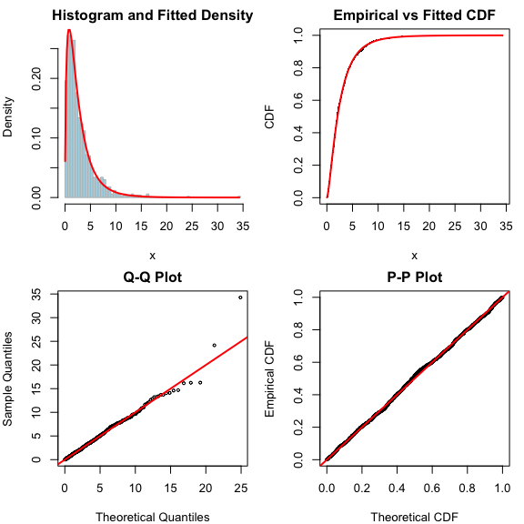
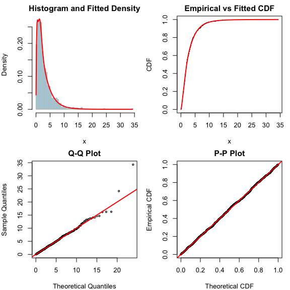
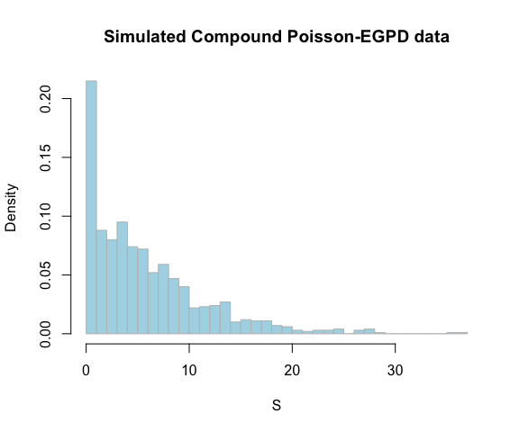
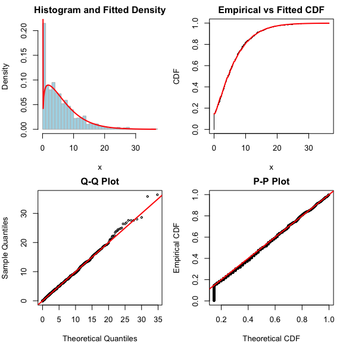
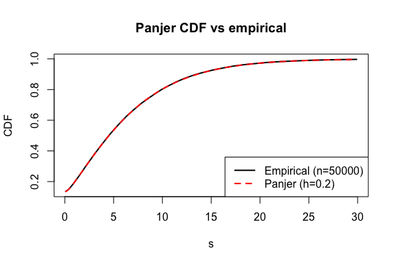

Fitting Continuous Distributions with distfit
================

The `distfit()` function provides a unified interface for fitting
univariate EGPD models by maximum likelihood. This vignette covers the
three continuous families:

1.  **Standard EGPD** (`family = "egpd"`) — parametric G-transformation
2.  **Bernstein EGPD** (`method = "bernstein"`) — semiparametric
    G-transformation using a Bernstein polynomial density
3.  **Compound Poisson EGPD** (`family = "cpegpd"`) — aggregated totals
    modelled via Panjer recursion

All three share the same GPD tail behaviour controlled by the shape
parameter $\xi$ and scale parameter $\sigma$, but differ in how they
model the body of the distribution.

## 1. Standard EGPD

The Extended GPD prepends a CDF transformation $G$ to the uniform
component of the GPD:

$$F(x) = G\!\bigl(H(x;\,\sigma,\xi)\bigr)$$

where $H$ is the standard GPD CDF. The `type` argument selects the
parametric form of $G$. Type 1 uses $G(u) = u^\kappa$ with a single
shape parameter $\kappa > 0$.

### Simulating and fitting

``` r
library(egpd)
set.seed(1)

# True parameters
sigma_true <- 2
xi_true    <- 0.1
kappa_true <- 1.5

x <- regpd(1000, sigma = sigma_true, xi = xi_true,
           kappa = kappa_true, type = 1)

fit_egpd <- distfit(x, type = 1, family = "egpd")
summary(fit_egpd)
```

    Fitting of the distribution 'egpd' (type 1)
    Method: mle

    Estimated parameters:
          Estimate Std. Error z value Pr(>|z|)    
    sigma  1.81437    0.15065  12.044  < 2e-16 ***
    xi     0.15340    0.03979   3.855 0.000116 ***
    kappa  1.61596    0.10591  15.258  < 2e-16 ***
    ---
    Signif. codes:  0 '***' 0.001 '**' 0.01 '*' 0.05 '.' 0.1 ' ' 1

    Convergence:  successful 
    Loglikelihood:  -2037.6   AIC:  4081.21   BIC:  4095.93 
    Number of observations:  1000 

### Diagnostics

The four-panel diagnostic plot shows the histogram with the fitted
density, empirical vs fitted CDF, a Q-Q plot, and a P-P plot.

``` r
plot(fit_egpd)
```



### Model comparison across types

Different types impose different shapes on $G$. We can compare them by
AIC:

``` r
aic_table <- data.frame(
  type = c(1, 4, 5),
  AIC = c(
    AIC(distfit(x, type = 1)),
    AIC(distfit(x, type = 4)),
    AIC(distfit(x, type = 5))
  )
)
aic_table
```

      type      AIC
    1    1 4081.205
    2    4 4083.362
    3    5 4082.882

Since the data were generated from Type 1, we expect it to have the
lowest AIC (or very close).

### Fixing parameters

Sometimes we want to fix one parameter at a known value. The `fix.arg`
argument removes it from optimization:

``` r
fit_fix <- distfit(x, type = 1, fix.arg = list(xi = 0.1))
summary(fit_fix)
```

    Fitting of the distribution 'egpd' (type 1)
    Method: mle

    Estimated parameters:
          Estimate Std. Error z value Pr(>|z|)    
    sigma  1.99271    0.08800   22.64   <2e-16 ***
    kappa  1.52383    0.07319   20.82   <2e-16 ***
    ---
    Signif. codes:  0 '***' 0.001 '**' 0.01 '*' 0.05 '.' 0.1 ' ' 1

    Fixed parameters:
       Value
    xi   0.1

    Convergence:  successful 
    Loglikelihood:  -2038.58   AIC:  4081.16   BIC:  4090.98 
    Number of observations:  1000 

The fixed parameter is shown separately in the summary output, and the
confidence intervals cover only the free parameters:

``` r
confint(fit_fix)
```

             2.5 %   97.5 %
    sigma 1.827483 2.172882
    kappa 1.386929 1.674247

## 2. Bernstein EGPD

The parametric $G$ in the standard EGPD may be too rigid for some
datasets. The Bernstein EGPD replaces it with a flexible Bernstein
polynomial density:

$$f(x) = b\!\bigl(H(x)^\kappa\bigr)\;\kappa\,H(x)^{\kappa-1}\,h(x)$$

where $b$ is a Bernstein polynomial density of degree $m$ with
softmax-parameterized weights. This gives a semiparametric model that
can approximate any smooth density on $(0,1)$.

### Fitting

Select `method = "bernstein"` and choose the polynomial degree with
`bernstein.m`. A two-stage procedure first estimates GPD parameters via
parametric MLE, then jointly optimizes all parameters.

``` r
fit_bern <- distfit(x, type = 1, method = "bernstein", bernstein.m = 8)
summary(fit_bern)
```

    Fitting of the distribution 'egpd' (type 1)
    Method: bernstein (Bernstein degree = 8)

    Estimated parameters:
          Estimate Std. Error z value Pr(>|z|)    
    sigma   1.4869     0.3112   4.778 1.77e-06 ***
    xi      0.1601     0.0502   3.189  0.00143 ** 
    kappa   1.8502     0.2806   6.594 4.27e-11 ***
    ---
    Signif. codes:  0 '***' 0.001 '**' 0.01 '*' 0.05 '.' 0.1 ' ' 1

    Convergence:  successful 
    Loglikelihood:  -2036.04   AIC:  4092.09   BIC:  4141.17 
    Number of observations:  1000 

The reported parameters are only $\sigma$, $\xi$, and $\kappa$; the
Bernstein weights are stored internally. The effective number of
parameters is $3 + (m - 1)$ since the $m$ weights sum to 1.

### Comparing parametric and semiparametric fits

``` r
cat("Parametric AIC:     ", AIC(fit_egpd), "\n")
```

    Parametric AIC:      4081.205 

``` r
cat("Bernstein (m=8) AIC:", AIC(fit_bern), "\n")
```

    Bernstein (m=8) AIC: 4092.09 

For well-specified parametric data the standard EGPD typically wins on
AIC due to fewer effective parameters. The Bernstein model is most
useful when the true $G$ is unknown or does not match any of the six
parametric types.

### Diagnostics

``` r
plot(fit_bern)
```



### Sensitivity to Bernstein degree

``` r
aic_m <- sapply(c(4, 6, 8, 12), function(m) {
  AIC(distfit(x, type = 1, method = "bernstein", bernstein.m = m))
})
data.frame(m = c(4, 6, 8, 12), AIC = round(aic_m, 2))
```

       m     AIC
    1  4 4086.59
    2  6 4088.77
    3  8 4092.09
    4 12 4096.76

## 3. Compound Poisson EGPD

The Compound Poisson EGPD models aggregated positive data (e.g. total
rainfall over a period) as the random sum $S = X_1 + \cdots + X_N$
where:

- $N \sim \mathrm{Poisson}(\lambda)$ is the number of events, and
- $X_i \sim \mathrm{EGPD}(\sigma, \xi, \kappa)$ are i.i.d. event sizes.

The distribution of $S$ has a point mass at zero
($P(S=0) = e^{-\lambda}$) and a positive part. Following [Ailliot,
Gaetan and Naveau
(2026)](https://doi.org/10.1016/j.advwatres.2026.105216) for aggregated
rainfall, each event size is recorded on a grid of width $h$, as by a
rain gauge with resolution $h$: an event of size $X$ is recorded as
$\lceil X/h \rceil h$. The functions `dcpegpd()`, `pcpegpd()`,
`qcpegpd()` and `rcpegpd()` all describe this gauge-discretised total
$$S_h = \sum_{i=1}^{N} \lceil X_i/h \rceil\, h$$ on the grid
$\{0, h, 2h, \ldots\}$ (argument `h`, default 0.2), and `rcpegpd(h = 0)`
simulates the continuous total $S$.

### Panjer recursion

The recorded event size has probability mass function (Ailliot et al.,
Appendix F, Eq. F.2) $$f_0 = 0,\qquad
f_k = F_{\mathrm{EGPD}}(kh) - F_{\mathrm{EGPD}}\bigl((k-1)h\bigr),\quad k \ge 1,$$
so the zero atom $P(S_h = 0) = e^{-\lambda}$ is exact. The compound
distribution is then computed recursively: $$g_0 = e^{-\lambda},\qquad
g_k = \frac{\lambda}{k}\sum_{j=1}^{k} j\,f_j\,g_{k-j},\quad k \ge 1.$$

### Simulating compound Poisson-EGPD data

`rcpegpd()` simulates directly (no Panjer recursion is needed): it draws
$N \sim \mathrm{Poisson}(\lambda)$ and sums $N$ i.i.d. EGPD event sizes,
each recorded on the same $h$-grid as the d/p/q functions.

``` r
set.seed(42)
sigma_true  <- 2
xi_true     <- 0.1
kappa_true  <- 1.5
lambda_true <- 2

y <- rcpegpd(1000, sigma = sigma_true, xi = xi_true,
             kappa = kappa_true, lambda = lambda_true, type = 1)

cat("Proportion of zeros:", mean(y == 0), "\n")
```

    Proportion of zeros: 0.147 

``` r
cat("Theoretical P(S=0):", exp(-lambda_true), "\n")
```

    Theoretical P(S=0): 0.1353353 

``` r
cat("Mean:", round(mean(y), 2), "\n")
```

    Mean: 5.82 

``` r
hist(y, breaks = 40, freq = FALSE, col = "lightblue", border = "grey",
     main = "Simulated Compound Poisson-EGPD data", xlab = "S")
```



### Fitting

Select `family = "cpegpd"`. The grid width is set by `cpegpd.h` (default
0.2) and should match the resolution at which the data were recorded,
here the default `h = 0.2` of `rcpegpd()`.

``` r
fit_cp <- distfit(y, type = 1, family = "cpegpd", cpegpd.h = 0.2)
summary(fit_cp)
```

    Fitting of the distribution 'cpegpd' (type 1)
    Method: mle (cpegpd discretization h = 0.2)

    Estimated parameters:
           Estimate Std. Error z value Pr(>|z|)    
    sigma   2.17503    0.30801   7.062 1.65e-12 ***
    xi      0.06631    0.06210   1.068    0.286    
    kappa   1.44035    0.17326   8.313  < 2e-16 ***
    lambda  1.92082    0.07641  25.139  < 2e-16 ***
    ---
    Signif. codes:  0 '***' 0.001 '**' 0.01 '*' 0.05 '.' 0.1 ' ' 1

    Convergence:  successful 
    Loglikelihood:  -2866.8   AIC:  5741.6   BIC:  5761.23 
    Number of observations:  1000 

``` r
truth <- c(sigma = sigma_true, xi = xi_true,
           kappa = kappa_true, lambda = lambda_true)
est <- fit_cp$estimate[names(truth)]
cbind(true = truth, estimate = round(est, 4),
      SE = round(fit_cp$sd[names(truth)], 4))
```

           true estimate     SE
    sigma   2.0   2.1750 0.3080
    xi      0.1   0.0663 0.0621
    kappa   1.5   1.4403 0.1733
    lambda  2.0   1.9208 0.0764

### Diagnostics

``` r
plot(fit_cp)
```



### Checking the Panjer recursion

The Panjer CDF should match the empirical distribution of a large
simulation from the same law. The CDF is evaluated midway between grid
points, where both are flat:

``` r
set.seed(1)
y_large <- rcpegpd(50000, sigma = sigma_true, xi = xi_true,
                    kappa = kappa_true, lambda = lambda_true, type = 1)
qvals <- (seq_len(150) - 0.5) * 0.2
emp_cdf <- sapply(qvals, function(q) mean(y_large <= q))
theo_cdf <- pcpegpd(qvals, lambda = lambda_true, sigma = sigma_true,
                     xi = xi_true, kappa = kappa_true, type = 1, h = 0.2)

plot(qvals, emp_cdf, type = "l", lwd = 2,
     xlab = "s", ylab = "CDF", main = "Panjer CDF vs empirical")
lines(qvals, theo_cdf, col = "red", lwd = 2, lty = 2)
legend("bottomright", c("Empirical (n=50000)", "Panjer (h=0.2)"),
       col = c("black", "red"), lty = 1:2, lwd = 2)
```



### Choosing the grid width

For gauge data, set `cpegpd.h` to the gauge resolution, so that the
model describes the recorded totals exactly. For continuous data, $h$ is
an approximation parameter: recording each event on the grid rounds it
up by less than $h$, so $S_h$ exceeds the continuous total by less than
$Nh$ (about $\lambda h / 2$ on average). The discretised CDF approaches
the continuous one as $h$ decreases, at a computational cost that grows
quadratically in $\max(x)/h$:

``` r
h_grid <- c(0.5, 0.2, 0.1, 0.05, 0.01)
q_check <- c(1, 2, 5, 10, 20)
cdf_h <- sapply(h_grid, function(hv) {
  pcpegpd(q_check, lambda = lambda_true, sigma = sigma_true, xi = xi_true,
          kappa = kappa_true, type = 1, h = hv)
})
dimnames(cdf_h) <- list(q = q_check, h = h_grid)
round(cdf_h, 4)
```

        h
    q       0.5    0.2    0.1   0.05   0.01
      1  0.2031 0.2050 0.2057 0.2061 0.2064
      2  0.2894 0.2949 0.2969 0.2979 0.2988
      5  0.5302 0.5425 0.5467 0.5488 0.5505
      10 0.7956 0.8065 0.8101 0.8118 0.8132
      20 0.9701 0.9729 0.9737 0.9741 0.9745

The `distfit()` log-likelihood uses the probability of an exact zero for
zero observations and the bin probability divided by `h` (a density
approximation) for positive ones, i.e. a likelihood with respect to a
point mass at zero plus Lebesgue measure. Log-likelihoods, and hence AIC
values, are therefore comparable across values of `h`, but not with
continuous families that place a density, not a mass, at zero.

### Confidence intervals

``` r
confint(fit_cp)
```

                 2.5 %    97.5 %
    sigma   1.64787460 2.8708118
    xi     -0.05540853 0.1880202
    kappa   1.13783144 1.8232931
    lambda  1.77675486 2.0765690

### Fixing parameters

As with other families, individual parameters can be fixed:

``` r
fit_cp_fix <- distfit(y, type = 1, family = "cpegpd",
                       fix.arg = list(xi = 0.1), cpegpd.h = 0.2)
summary(fit_cp_fix)
```

    Fitting of the distribution 'cpegpd' (type 1)
    Method: mle (cpegpd discretization h = 0.2)

    Estimated parameters:
           Estimate Std. Error z value Pr(>|z|)    
    sigma   2.02601    0.12455   16.27   <2e-16 ***
    kappa   1.50799    0.13347   11.30   <2e-16 ***
    lambda  1.92941    0.07514   25.68   <2e-16 ***
    ---
    Signif. codes:  0 '***' 0.001 '**' 0.01 '*' 0.05 '.' 0.1 ' ' 1

    Fixed parameters:
       Value
    xi   0.1

    Convergence:  successful 
    Loglikelihood:  -2866.96   AIC:  5739.92   BIC:  5754.64 
    Number of observations:  1000 

## Summary

| Method | Family | Parameters | Use case |
|----|----|----|----|
| `method="mle"` | `"egpd"` | $\sigma, \xi$ + type-specific | Standard parametric EGPD |
| `method="bernstein"` | `"egpd"` | $\sigma, \xi, \kappa$ + weights | Flexible body, unknown $G$ |
| `method="mle"` | `"cpegpd"` | $\sigma, \xi$ + type-specific + $\lambda$ | Aggregated data with zeros |

All three approaches:

- Return S3 objects of class `"distfit"` with the same interface
  (`summary`, `plot`, `AIC`, `confint`, `coef`, `vcov`, `logLik`)
- Support `fix.arg` for fixing parameters at known values
- Estimate standard errors via the delta method on the Hessian
- Provide four-panel diagnostic plots
