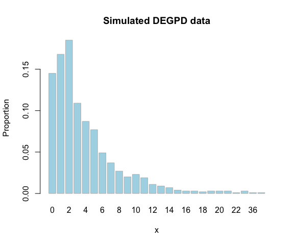
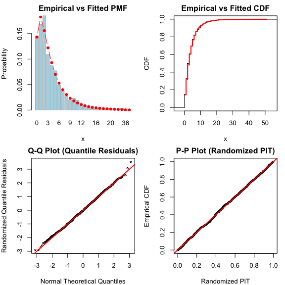
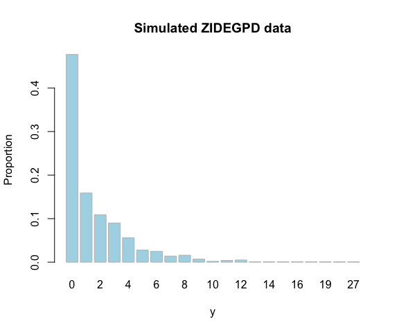
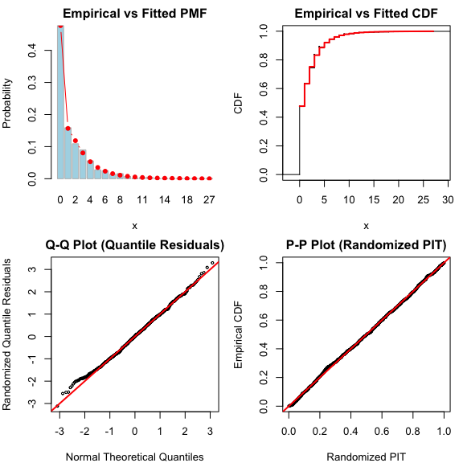
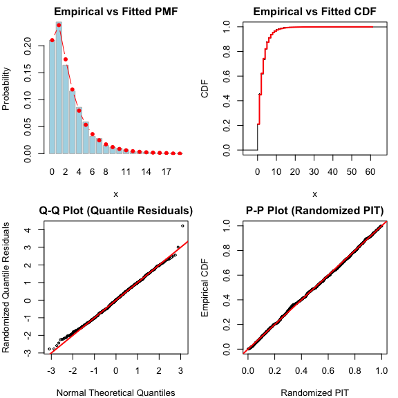
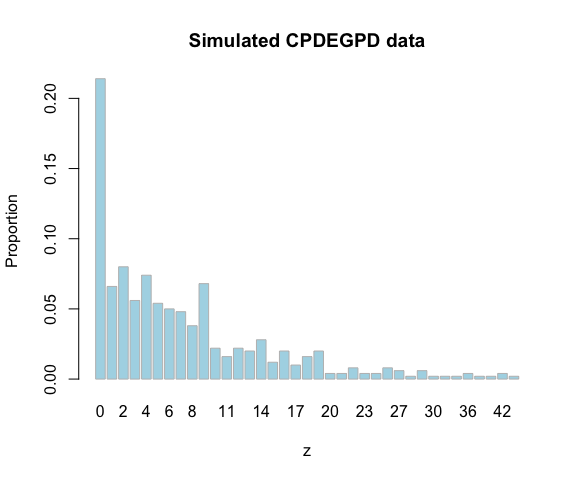
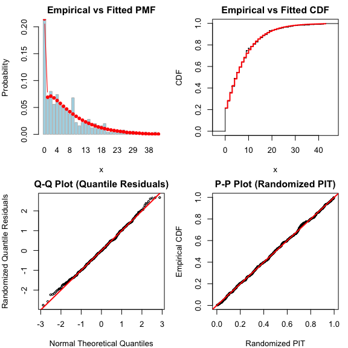

Fitting Discrete Distributions with distfit
================

The `distfit()` function supports two discrete distribution families for
fitting non-negative integer (count) data:

1.  **Discrete EGPD** (`family = "degpd"`) — for counts without excess
    zeros
2.  **Zero-Inflated Discrete EGPD** (`family = "zidegpd"`) — for counts
    with more zeros than the base model can accommodate

Both discretize the continuous EGPD by placing the probability mass of
each integer $k$ at
$P(X = k) = F_{\mathrm{EGPD}}(k+1) - F_{\mathrm{EGPD}}(k)$, inheriting
the flexible body and Pareto tail of the continuous model. This makes
them natural alternatives to the Poisson, negative binomial, or
Conway–Maxwell–Poisson for heavy-tailed or over-dispersed count data.

## 1. Discrete EGPD

### The model

The discrete EGPD (DEGPD) has PMF

$$P(X = k) = G\!\bigl(H(k+1)\bigr) - G\!\bigl(H(k)\bigr), \qquad k = 0, 1, 2, \ldots$$

where $H$ is the standard GPD CDF and $G$ is the EGPD transformation
function. As with the continuous EGPD, the `type` argument selects the
parametric form of $G$.

### Simulating and fitting

We generate data from a DEGPD Type 1 model and fit it back.

``` r
library(egpd)
set.seed(1)

sigma_true <- 3
xi_true    <- 0.1
kappa_true <- 1.5

x <- rdiscegpd(1000, sigma = sigma_true, xi = xi_true,
               kappa = kappa_true, type = 1)

cat("Range:", range(x), "\n")
```

    Range: 0 51 

``` r
cat("Mean:", round(mean(x), 2), "  Var:", round(var(x), 2), "\n")
```

    Mean: 3.89   Var: 19 

``` r
cat("Proportion zeros:", mean(x == 0), "\n")
```

    Proportion zeros: 0.145 

``` r
barplot(table(x) / length(x), main = "Simulated DEGPD data",
        xlab = "x", ylab = "Proportion", col = "lightblue", border = "grey")
```



``` r
fit_degpd <- distfit(x, type = 1, family = "degpd")
summary(fit_degpd)
```

    Fitting of the distribution 'degpd' (type 1)
    Method: mle

    Estimated parameters:
          Estimate Std. Error z value Pr(>|z|)    
    sigma   2.7904     0.2744  10.169  < 2e-16 ***
    xi      0.1437     0.0431   3.335 0.000854 ***
    kappa   1.5913     0.1349  11.797  < 2e-16 ***
    ---
    Signif. codes:  0 '***' 0.001 '**' 0.01 '*' 0.05 '.' 0.1 ' ' 1

    Convergence:  successful 
    Loglikelihood:  -2457.38   AIC:  4920.77   BIC:  4935.49 
    Number of observations:  1000 

### Parameter recovery

``` r
truth <- c(sigma = sigma_true, xi = xi_true, kappa = kappa_true)
est <- fit_degpd$estimate[names(truth)]
cbind(true = truth, estimate = round(est, 4),
      SE = round(fit_degpd$sd[names(truth)], 4))
```

          true estimate     SE
    sigma  3.0   2.7904 0.2744
    xi     0.1   0.1437 0.0431
    kappa  1.5   1.5913 0.1349

### Diagnostics

The diagnostic plot for discrete families shows the empirical PMF with
fitted probabilities (panel 1), a step-function CDF comparison (panel
2), a normal Q-Q plot of randomized quantile residuals (panel 3), and a
P-P plot using the randomized probability integral transform (panel 4).
The randomized PIT (Dunn & Smyth, 1996) spreads tied discrete values
into continuous uniform variates, producing clean diagonal plots instead
of the banded patterns that arise from integer-valued quantiles.

``` r
plot(fit_degpd)
```



### Comparing types by AIC

Different G-transformation types suit different data shapes. We can use
AIC to select among them:

``` r
aic_table <- data.frame(
  type = c(1, 4, 5),
  AIC = c(
    AIC(distfit(x, type = 1, family = "degpd")),
    AIC(distfit(x, type = 4, family = "degpd")),
    AIC(distfit(x, type = 5, family = "degpd"))
  )
)
aic_table
```

      type      AIC
    1    1 4920.769
    2    4 4921.978
    3    5 4922.721

### Confidence intervals

``` r
confint(fit_degpd)
```

               2.5 %    97.5 %
    sigma 2.30122824 3.3835942
    xi    0.05924917 0.2282084
    kappa 1.34769210 1.8788618

### Fixing parameters

As with continuous fits, individual parameters can be fixed at known
values:

``` r
fit_fix <- distfit(x, type = 1, family = "degpd",
                    fix.arg = list(xi = 0.1))
summary(fit_fix)
```

    Fitting of the distribution 'degpd' (type 1)
    Method: mle

    Estimated parameters:
          Estimate Std. Error z value Pr(>|z|)    
    sigma   3.0395     0.1473   20.64   <2e-16 ***
    kappa   1.4958     0.0849   17.62   <2e-16 ***
    ---
    Signif. codes:  0 '***' 0.001 '**' 0.01 '*' 0.05 '.' 0.1 ' ' 1

    Fixed parameters:
       Value
    xi   0.1

    Convergence:  successful 
    Loglikelihood:  -2457.94   AIC:  4919.87   BIC:  4929.69 
    Number of observations:  1000 

## 2. Zero-Inflated Discrete EGPD

### The model

Many count datasets have more zeros than any standard count model can
explain — e.g. the number of insurance claims (many policyholders file
none), species counts (many sites have zero individuals), or disease
counts (many days with no cases). The zero-inflated discrete EGPD
(ZIDEGPD) handles this by mixing a point mass at zero with the DEGPD:

$$P(X = k) = \begin{cases}
\pi + (1-\pi)\,P_{\mathrm{DEGPD}}(X=0) & k = 0 \\
(1-\pi)\,P_{\mathrm{DEGPD}}(X=k) & k \ge 1
\end{cases}$$

where $\pi \in (0,1)$ is the zero-inflation probability. The overall
zero probability is $\pi + (1-\pi)\,P_{\mathrm{DEGPD}}(0)$, which is
always larger than $P_{\mathrm{DEGPD}}(0)$ alone.

### Simulating and fitting

``` r
set.seed(42)

sigma_true <- 2
xi_true    <- 0.1
kappa_true <- 1.5
pi_true    <- 0.3

y <- rzidiscegpd(1000, pi = pi_true, sigma = sigma_true,
                  xi = xi_true, kappa = kappa_true, type = 1)

cat("Range:", range(y), "\n")
```

    Range: 0 27 

``` r
cat("Mean:", round(mean(y), 2), "  Var:", round(var(y), 2), "\n")
```

    Mean: 1.72   Var: 7.42 

``` r
cat("Proportion zeros:", mean(y == 0), "\n")
```

    Proportion zeros: 0.477 

The zero proportion should be notably higher than for the non-inflated
model because of the extra $\pi = 0.3$ point mass.

``` r
barplot(table(y) / length(y), main = "Simulated ZIDEGPD data",
        xlab = "y", ylab = "Proportion", col = "lightblue", border = "grey")
```



``` r
fit_zi <- distfit(y, type = 1, family = "zidegpd")
summary(fit_zi)
```

    Fitting of the distribution 'zidegpd' (type 1)
    Method: mle

    Estimated parameters:
          Estimate Std. Error z value Pr(>|z|)    
    sigma  1.75169    0.45650   3.837 0.000124 ***
    xi     0.15809    0.07373   2.144 0.032034 *  
    kappa  1.98120    0.83980   2.359 0.018318 *  
    pi     0.36204    0.05978   6.056  1.4e-09 ***
    ---
    Signif. codes:  0 '***' 0.001 '**' 0.01 '*' 0.05 '.' 0.1 ' ' 1

    Convergence:  successful 
    Loglikelihood:  -1745.38   AIC:  3498.76   BIC:  3518.39 
    Number of observations:  1000 

### Parameter recovery

``` r
truth <- c(sigma = sigma_true, xi = xi_true,
           kappa = kappa_true, pi = pi_true)
est <- fit_zi$estimate[names(truth)]
cbind(true = truth, estimate = round(est, 4),
      SE = round(fit_zi$sd[names(truth)], 4))
```

          true estimate     SE
    sigma  2.0   1.7517 0.4565
    xi     0.1   0.1581 0.0737
    kappa  1.5   1.9812 0.8398
    pi     0.3   0.3620 0.0598

### Diagnostics

``` r
plot(fit_zi)
```



### Confidence intervals

``` r
confint(fit_zi)
```

               2.5 %    97.5 %
    sigma 1.05106625 2.9193546
    xi    0.01356924 0.3026051
    kappa 0.86320847 4.5471597
    pi    0.25467255 0.4851977

## 3. Comparing DEGPD and ZIDEGPD

When faced with zero-heavy count data, a natural question is whether the
zero inflation is needed or whether the base DEGPD already accounts for
the zeros adequately. We can compare the two models by AIC.

### Fitting both models to zero-inflated data

``` r
fit_no_zi <- distfit(y, type = 1, family = "degpd")
fit_with_zi <- fit_zi  # already fitted above

cat("DEGPD AIC:   ", AIC(fit_no_zi), "\n")
```

    DEGPD AIC:    3503.567 

``` r
cat("ZIDEGPD AIC: ", AIC(fit_with_zi), "\n")
```

    ZIDEGPD AIC:  3498.756 

Since the data were generated with $\pi = 0.3$, the zero-inflated model
should have a substantially lower AIC.

### Fitting both models to non-inflated data

Conversely, when the data have no excess zeros, the extra $\pi$
parameter should not help:

``` r
fit_degpd_on_x <- fit_degpd  # fitted to non-inflated x above
fit_zi_on_x <- distfit(x, type = 1, family = "zidegpd")

cat("DEGPD AIC:   ", AIC(fit_degpd_on_x), "\n")
```

    DEGPD AIC:    4920.769 

``` r
cat("ZIDEGPD AIC: ", AIC(fit_zi_on_x), "\n")
```

    ZIDEGPD AIC:  4922.4 

``` r
cat("Estimated pi:", round(fit_zi_on_x$estimate["pi"], 4), "\n")
```

    Estimated pi: 0.0281 

The estimated $\pi$ should be near zero and the ZIDEGPD AIC slightly
higher (penalised for the extra parameter).

## 4. Higher-order types

Types 5 and 6 provide additional flexibility. Type 5 has both $\delta$
and $\kappa$ parameters; Type 6 adds a mixing probability $p$.

``` r
set.seed(99)
x5 <- rdiscegpd(1000, sigma = 2, xi = 0.1, delta = 1.2,
                 kappa = 1.8, type = 5)
fit5 <- distfit(x5, type = 5, family = "degpd")
summary(fit5)
```

    Fitting of the distribution 'degpd' (type 5)
    Method: mle

    Estimated parameters:
          Estimate Std. Error z value Pr(>|z|)    
    sigma  1.63669    0.60431   2.708  0.00676 ** 
    xi     0.15601    0.03924   3.976 7.01e-05 ***
    delta  0.41348    0.97301   0.425  0.67087    
    kappa  1.65992    0.15864  10.464  < 2e-16 ***
    ---
    Signif. codes:  0 '***' 0.001 '**' 0.01 '*' 0.05 '.' 0.1 ' ' 1

    Convergence:  successful 
    Loglikelihood:  -2117.78   AIC:  4243.56   BIC:  4263.19 
    Number of observations:  1000 

``` r
plot(fit5)
```



## 5. Compound Poisson-Discrete EGPD

### The model

The Compound Poisson-Discrete EGPD (`family = "cpdegpd"`) models the
aggregate sum $S = X_1 + \cdots + X_N$ where

- $N \sim \mathrm{Poisson}(\lambda)$ is the random number of events, and
- $X_i \sim \mathrm{Discrete\text{-}EGPD}(\sigma, \xi, \kappa, \ldots)$
  are i.i.d. non-negative integer severities.

Since the individual claims are already integer-valued, the Panjer
recursion computes an **exact** compound distribution on
$\{0, 1, 2, \ldots\}$ — no discretization step is needed and there is no
bin-width parameter `h` to tune (unlike `family = "cpegpd"`).

### Simulating and fitting

``` r
set.seed(42)

sigma_true  <- 3
xi_true     <- 0.1
kappa_true  <- 1.5
lambda_true <- 2

z <- rcpdegpd(500, sigma = sigma_true, xi = xi_true,
               kappa = kappa_true, lambda = lambda_true, type = 1)

cat("Range:", range(z), "\n")
```

    Range: 0 43 

``` r
cat("Mean:", round(mean(z), 2), "  Var:", round(var(z), 2), "\n")
```

    Mean: 7.03   Var: 61.4 

``` r
cat("Proportion zeros:", mean(z == 0), "\n")
```

    Proportion zeros: 0.214 

``` r
barplot(table(z) / length(z), main = "Simulated CPDEGPD data",
        xlab = "z", ylab = "Proportion", col = "lightblue", border = "grey")
```



``` r
fit_cpdegpd <- distfit(z, type = 1, family = "cpdegpd")
summary(fit_cpdegpd)
```

    Fitting of the distribution 'cpdegpd' (type 1)
    Method: mle

    Estimated parameters:
           Estimate Std. Error z value Pr(>|z|)    
    sigma    2.7410     1.0987   2.495   0.0126 *  
    xi       0.1487     0.1134   1.312   0.1896    
    kappa    1.6657     1.0135   1.643   0.1003    
    lambda   1.7761     0.2368   7.501 6.33e-14 ***
    ---
    Signif. codes:  0 '***' 0.001 '**' 0.01 '*' 0.05 '.' 0.1 ' ' 1

    Convergence:  successful 
    Loglikelihood:  -1488.58   AIC:  2985.17   BIC:  3002.02 
    Number of observations:  500 

### Parameter recovery

``` r
truth <- c(sigma = sigma_true, xi = xi_true,
           kappa = kappa_true, lambda = lambda_true)
est <- fit_cpdegpd$estimate[names(truth)]
cbind(true = truth, estimate = round(est, 4),
      SE = round(fit_cpdegpd$sd[names(truth)], 4))
```

           true estimate     SE
    sigma   3.0   2.7410 1.0987
    xi      0.1   0.1487 0.1134
    kappa   1.5   1.6657 1.0135
    lambda  2.0   1.7761 0.2368

### Diagnostics

The diagnostic plots use discrete-style panels: a barplot with fitted
PMF points, a step-function CDF, and randomized PIT-based Q-Q and P-P
plots.

``` r
plot(fit_cpdegpd)
```



### Comparing with plain DEGPD on the same data

Since `cpdegpd` is a compound sum model while `degpd` is a single-event
model, we can compare their AIC on the same data to see which fits
better:

``` r
fit_degpd_on_z <- distfit(z, type = 1, family = "degpd")

cat("DEGPD AIC:   ", AIC(fit_degpd_on_z), "\n")
```

    DEGPD AIC:    2995.597 

``` r
cat("CPDEGPD AIC: ", AIC(fit_cpdegpd), "\n")
```

    CPDEGPD AIC:  2985.166 

The compound model should fit noticeably better when the data-generating
process truly involves random summation.

## 6. Practical guidelines

**Choosing between DEGPD and ZIDEGPD.** Start with `family = "degpd"`.
If the diagnostic plots show the model underestimates the zero
probability, refit with `family = "zidegpd"` and compare by AIC.

**Choosing the type.** Fit several types and compare AIC. Types 1 and 4
have three parameters and are good defaults. Type 5 (four parameters)
and Type 6 (five parameters) offer more flexibility but need larger
samples.

**Starting values.** The automatic starting values work well in most
cases. For difficult datasets (e.g. very heavy tails), supply custom
start values via `start = list(sigma = ..., xi = ...)`.

**Fixed parameters.** Use `fix.arg` when external information is
available — e.g. `fix.arg = list(xi = 0)` for an exponential tail.

## Summary

| Family | Parameters | Zero mechanism | Use case |
|----|----|----|----|
| `"degpd"` | $\sigma, \xi$ + type-specific | Natural zeros from DEGPD | Standard count data |
| `"zidegpd"` | $\sigma, \xi$ + type-specific + $\pi$ | Extra point mass at zero | Counts with excess zeros |
| `"cpdegpd"` | $\sigma, \xi$ + type-specific + $\lambda$ | Poisson zero ($N=0$) | Aggregate integer sums |

All families:

- Return S3 objects of class `"distfit"` with the same interface
  (`summary`, `plot`, `AIC`, `confint`, `coef`, `vcov`, `logLik`)
- Support `fix.arg` for fixing parameters at known values
- Estimate standard errors via the delta method on the Hessian
- Provide four-panel diagnostic plots tailored for discrete data (bar
  plots for PMF, step functions for CDF, randomized PIT-based Q-Q and
  P-P plots)
