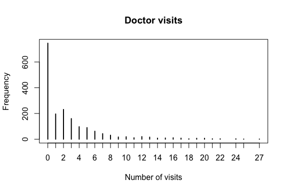
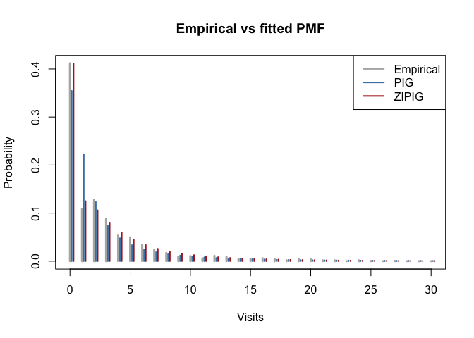
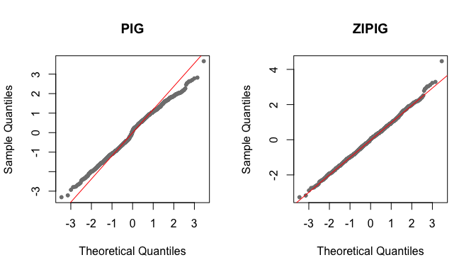

Poisson-Inverse Gaussian Models for Overdispersed Counts
================

The Poisson-inverse Gaussian (PIG) distribution is a mixed-Poisson
model: a Poisson mean that is itself inverse-Gaussian distributed. The
result is a count distribution that accommodates far more overdispersion
than the Poisson, with a heavier right tail than the negative binomial.
In `egpd` the mean parameterisation is used,

$$\mathbb{E}(Y) = \mu, \qquad \mathrm{Var}(Y) = \mu + \sigma\,\mu^2,$$

so `mu` (log link) is the mean and `sigma` (log link) controls
overdispersion. The zero-inflated variant (ZIPIG) adds a point mass at
zero of probability `pi` (logit link) for data with more zeros than the
PIG alone predicts.

This vignette fits PIG and ZIPIG to doctor-visit counts and compares
them with a Poisson baseline.

## Data

``` r
library(egpd)
data(docvisits)
y <- docvisits$visits
cat("n =", length(y), "  mean =", round(mean(y), 2),
    "  var =", round(var(y), 1), "\n")
```

    n = 1812   mean = 2.96   var = 27.3 

``` r
cat("proportion of zeros:", round(mean(y == 0), 3),
    "  dispersion (var/mean):", round(var(y) / mean(y), 1), "\n")
```

    proportion of zeros: 0.412   dispersion (var/mean): 9.2 

``` r
plot(table(y[y <= 30]), main = "Doctor visits",
     xlab = "Number of visits", ylab = "Frequency")
```



The variance is roughly nine times the mean and 41% of the observations
are zero: the Poisson is clearly inadequate.

## Fitting with `egpd()`

The native GAM fitter takes a list of parameter formulae. For
intercept-only models every parameter gets `~ 1`.

``` r
df <- data.frame(y = y)

fit_pig  <- egpd(list(lmu = y ~ 1, lsigma = ~ 1),
                 data = df, family = "pig")
fit_zip  <- egpd(list(lmu = y ~ 1, lsigma = ~ 1, logitpi = ~ 1),
                 data = df, family = "zipig")

summary(fit_pig)
```


    ** Parametric terms **

    logmu
                Estimate Std. Error z value Pr(>|z|)
    (Intercept)     1.08       0.05   23.34   <2e-16

    logsigma
                Estimate Std. Error z value Pr(>|z|)
    (Intercept)     1.27       0.08   16.01   <2e-16

    ** Smooth terms **

The fitted parameters are recovered on the response scale with
`predict()`.

``` r
p_pig <- predict(fit_pig, type = "response")[1, ]
p_zip <- predict(fit_zip, type = "response")[1, ]
p_pig
```

            mu    sigma
    1 2.958057 3.574642

``` r
p_zip
```

            mu    sigma        pi
    1 4.290044 1.288226 0.3104833

## Comparison with the Poisson

``` r
fit_pois <- glm(y ~ 1, family = poisson)

comparison <- data.frame(
  model  = c("Poisson", "PIG", "ZIPIG"),
  npar   = c(1, 2, 3),
  logLik = c(as.numeric(logLik(fit_pois)),
             as.numeric(logLik(fit_pig)),
             as.numeric(logLik(fit_zip))),
  AIC    = c(AIC(fit_pois), AIC(fit_pig), AIC(fit_zip))
)
comparison
```

        model npar    logLik       AIC
    1 Poisson    1 -6813.718 13629.436
    2     PIG    2 -3949.848  7903.696
    3   ZIPIG    3 -3869.747  7745.495

Both mixed-Poisson models dominate the Poisson, and the zero-inflated
PIG is preferred, reflecting the excess zeros.

## Fitted versus empirical PMF

``` r
xv <- 0:30
emp <- tabulate(y + 1, nbins = max(xv) + 1)[seq_along(xv)] / length(y)

pmf_pig <- dpig(xv, mu = p_pig$mu, sigma = p_pig$sigma)
pmf_zip <- dzipig(xv, mu = p_zip$mu, sigma = p_zip$sigma, pi = p_zip$pi)

plot(xv, emp, type = "h", lwd = 3, col = "grey70",
     main = "Empirical vs fitted PMF", xlab = "Visits", ylab = "Probability")
lines(xv + 0.15, pmf_pig, type = "h", lwd = 2, col = "steelblue")
lines(xv + 0.30, pmf_zip, type = "h", lwd = 2, col = "firebrick")
legend("topright", c("Empirical", "PIG", "ZIPIG"), lwd = 2,
       col = c("grey70", "steelblue", "firebrick"))
```



## Randomized quantile residuals

`rqresid()` returns randomized quantile residuals: for a discrete model
it draws $u \sim \mathrm{Unif}(F(y-1), F(y))$ and returns
$\Phi^{-1}(u)$, which are standard normal if the model is correct.

``` r
r_pig <- rqresid(fit_pig, seed = 1)
r_zip <- rqresid(fit_zip, seed = 1)

par(mfrow = c(1, 2))
qqnorm(r_pig, main = "PIG", pch = 20, col = "grey50"); qqline(r_pig, col = "red")
qqnorm(r_zip, main = "ZIPIG", pch = 20, col = "grey50"); qqline(r_zip, col = "red")
```



``` r
par(mfrow = c(1, 1))
```

## Other fitting interfaces

The same distribution is available through the univariate
maximum-likelihood fitter `distfit()`, and as `gamlss` / `bamlss`
families:

``` r
fit_uni <- distfit(y, family = "pig")
fit_uni$estimate
```

          mu    sigma 
    2.958968 3.575785 

``` r
## PIG()/ZIPIG() (gamlss.dist) and pig_bamlss()/zipig_bamlss() provide the
## same distribution for distributional-regression frameworks.
```

The `dpig`, `ppig`, `qpig` and `rpig` functions (and their `zipig`
counterparts) give the density, distribution, quantile and simulation
functions directly. See also `vignette("gpig-counts")` for the
heavier-tailed generalised PIG.
